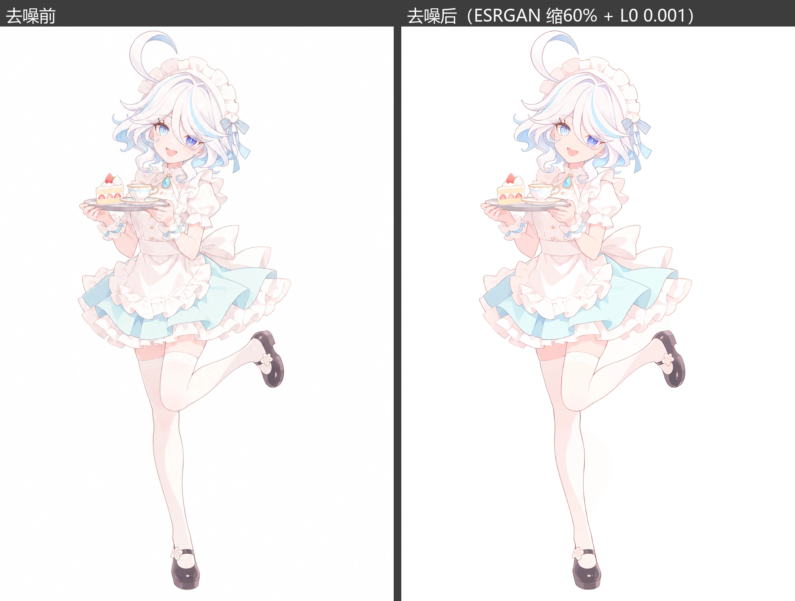
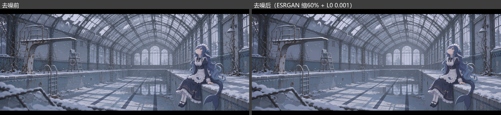
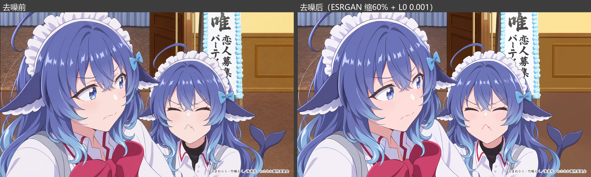
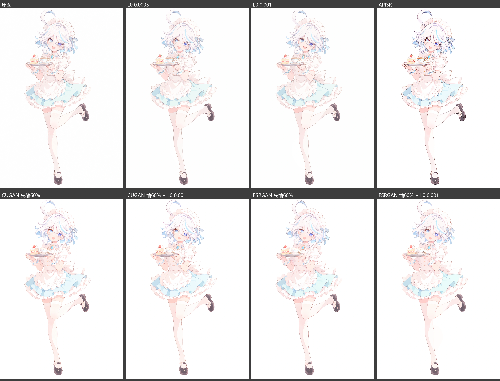
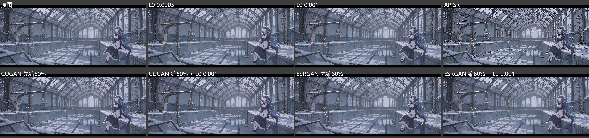
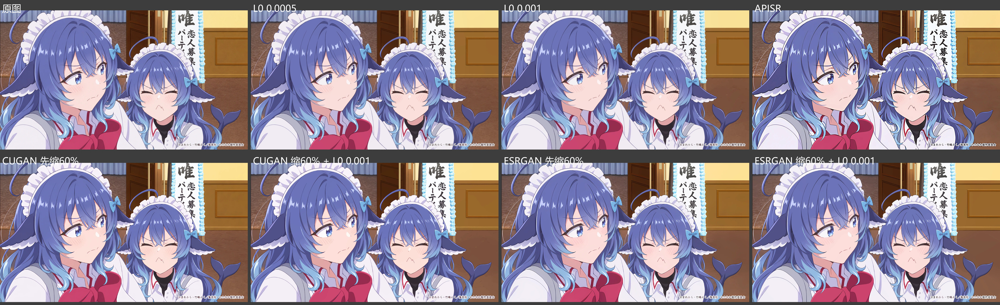

# gpt-anime-denoise

去掉 GPT 生图（gpt-image-2 / 2.5、ChatGPT、Codex 内置 image_gen）在**二次元 / 番剧画风**图里留下的**鱼鳞状噪点**。

Removes the fish-scale texture that OpenAI's GPT image models leave in anime and TV-anime style images, without redrawing the picture.

**默认推荐：ESRGAN 缩 60% + L0 0.001** —— 对动漫与番剧画风有奇效。

```bash
pip install -r requirements.txt          # 先按 pytorch.org 装好对应 CUDA 的 torch
python denoise.py image.png              # 默认方案，输出在 image_denoise/
python denoise.py image.png --all        # 7 种候选 + 一张 4×2 对比图
python denoise.py ./folder --out ./clean # 批量
```

模型在第一次运行时自动下载到 `~/.cache/gpt-anime-denoise`（共约 100 MB，带 SHA-256 校验），也可以用 `--models` 指定已有目录。有 NVIDIA 显卡最好；没有时自动用 CPU，会慢很多。一张约 1.6 MP 的图默认方案约 20 秒（L0 占大头）。

## 效果

左边去噪前，右边默认方案去噪后。**请点开看原尺寸**，缩小后鳞纹看不出来。

### 粉彩白底插画



### 电影感宽幅场景



### 番剧截帧质感



### 八种方法对比

每张都是原尺寸并排：原图、L0 0.0005、L0 0.001、APISR、CUGAN 缩 60%、CUGAN 缩 60% + L0、ESRGAN 缩 60%、**ESRGAN 缩 60% + L0（默认）**。用 `--all` 可以对自己的图生成同样的对比图，挑最合适的一种。





## 原理

默认方案分两步：

1. **先缩到 60% 再用动漫超分放回原尺寸。** 鳞纹是很细很密的纹样，缩小时几个像素被平均成一个，纹样基本消失；Real-ESRGAN anime 6B 放大时按它学过的干净动漫图重新补细节，所以 GPT 的纹理不会被带回来。
2. **再做一次轻度 L0 平滑（λ = 0.001）。** L0 梯度最小化（Xu et al. 2011）让整张图里"颜色有变化的像素"尽量少：色块内部的小起伏被压成一块平色，真正的线条和色块边缘因为跳变大而原样保留，不会变软。它是纯数学优化，不会编造细节，眼睛、腮红的位置和颜色都不变。λ 太大（如 0.01）会把淡渐变和腮红抹掉。

其他候选：

| 方法 | 说明 |
|---|---|
| L0 0.0005 / 0.001 | 只做 L0 平滑，改动最小 |
| APISR | 直接 2x 超分（不先缩小），本身已经很干净，不需要再叠 L0 |
| CUGAN 缩 60%（+ L0） | Real-CUGAN 降噪 3 档，比 ESRGAN 抹得更平 |
| ESRGAN 缩 60%（+ L0） | 默认方案 |

### 试过但效果不好的方法

- [Larryvrh/gpt-image-2-artifact-cleaner](https://github.com/Larryvrh/gpt-image-2-artifact-cleaner)：专门针对 GPT Image 2，但 α 开到 1.0 也只改善一点。
- 2x-AnimeSharpV4：几乎不改动画面。
- 导向滤波、双边滤波：会把画面抹糊。
- 1x-DitherDeleterV3-Smooth、1x-DeSharpen：都不如单用 L0。
- 扩散模型低强度重绘（img2img）、ControlNet：能去掉纹理，但会重画眼睛等小细节，角色设计会变。
- 频域陷波：这种纹理在频谱上没有明显的周期尖峰，没有可挖的频点。

## 作为 Claude Code / Codex skill 使用

把整个目录放进 `.claude/skills/gpt-anime-denoise/`（或 Codex 的 skills 目录），`SKILL.md` 会告诉 agent 在 GPT 出完二次元图后跑这一步。

## 许可

- 代码：MIT（见 `LICENSE`）。
- 模型不随仓库分发，脚本从原作者发布地址下载，使用时遵守各自的许可：[Real-ESRGAN](https://github.com/xinntao/Real-ESRGAN)（BSD-3-Clause）、[APISR](https://github.com/Kiteretsu77/APISR)（GPL-3.0）、[Real-CUGAN](https://github.com/bilibili/ailab)。
- 示例图由 GPT 生成，只作效果演示：
  - 鲸娘 DeepSeek 角色设计来自 [ZipZipPipe《AI娘化》](https://www.pixiv.net/artworks/148186519)（作者声明 CC BY-NC-SA 4.0）。
  - 芙宁娜是《原神》角色（© HoYoverse），属于同人图。
  - 番剧截帧那张以 TV 动画《わたしが恋人になれるわけないじゃん、ムリムリ！》第 4 话官方先行场面图为构图参考（© みかみてれん・竹嶋えく／集英社・わたなれ製作委員会），画面里右下角的小字是生成时产生的乱码。
  - 示例图不适用代码的 MIT 许可，不可商用。
